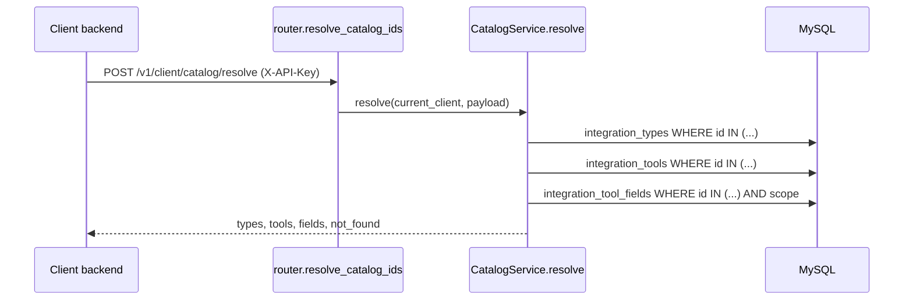

# Client Catalog (resolving stored ids)

Package: `app/features/catalog/`

## Overview

Client backends store integration catalogue ids as references instead
of copying names. EveryCRED, for example, keeps three ids on each
credential field:

| EveryCRED column               | Id of                   | Table                     |
|--------------------------------|-------------------------|---------------------------|
| `source_role_id`               | integration type        | `integration_types`       |
| `source_system_id`             | integration tool        | `integration_tools`       |
| `field_mapping_reference_uuid` | tool field              | `integration_tool_fields` |

To show those records, the client needs the names and field keys back.
This feature resolves any number of ids of each kind in one request, so
a client can resolve a whole page of records with a single call.

## Endpoints

### `POST /v1/client/catalog/resolve`

Authenticated with the client's `X-API-Key`. POST rather than GET
because a page can carry hundreds of ids.

Request (every list optional, up to 500 ids each, duplicates allowed):

```json
{
  "type_ids": ["00000000-0000-0000-0000-000000000001"],
  "tool_ids": ["00000000-0000-0000-0000-000000000002"],
  "field_ids": [
    "00000000-0000-0000-0000-000000000003",
    "00000000-0000-0000-0000-000000000009"
  ]
}
```

Response `200`:

```json
{
  "types": [
    {
      "id": "00000000-0000-0000-0000-000000000001",
      "code": "declare",
      "name": "Declare",
      "description": null,
      "is_active": true
    }
  ],
  "tools": [
    {
      "id": "00000000-0000-0000-0000-000000000002",
      "code": "holder-wallet-app",
      "name": "Holder Wallet App",
      "is_active": true
    }
  ],
  "fields": [
    {
      "id": "00000000-0000-0000-0000-000000000003",
      "integration_tool_id": "00000000-0000-0000-0000-000000000002",
      "flow": "kyc",
      "key": "full_name",
      "label": "Full Name"
    }
  ],
  "not_found": {
    "type_ids": [],
    "tool_ids": [],
    "field_ids": ["00000000-0000-0000-0000-000000000009"]
  }
}
```

Errors: `401` for a missing or invalid key, `422` for a malformed id,
an unknown body key, or more than 500 ids of one kind.

## Flow



`CatalogService.resolve` de-duplicates each id list, runs one query per
kind through the existing repositories (`get_by_ids`), and lists every
id without a match in `not_found`.

## Design decisions

- **Partial results, never a failure.** Admins hard-delete fields and
  nothing is soft-deleted, so a stored field id can dangle. One stale
  id is reported in `not_found`; the other ids still resolve.
- **Inactive types and tools resolve.** A record that stored the id
  still needs its name after an admin switches the type or tool off.
  `is_active` lets the caller mark it.
- **Field scoping.** Types and tools are global, but a field resolves
  only when global (`client_id IS NULL`) or the caller's own. Another
  client's field is reported as not found, the same as a missing one,
  so ids cannot be probed across clients.
- **Ids differ per environment.** Seeded types and tools get random
  UUIDs, so the same `declare` type has a different id in each
  environment. `code` is the stable identifier; callers that copy data
  between environments should keep codes alongside ids.

## Known limitations

- No caching or change events: a caller that caches results decides its
  own expiry.

## Testing

`tests/features/catalog/test_resolve_api.py` covers names and keys for
each kind, inactive types, unknown ids, duplicate ids, field scoping
between clients, the API key requirement, and the 500-id limit.
