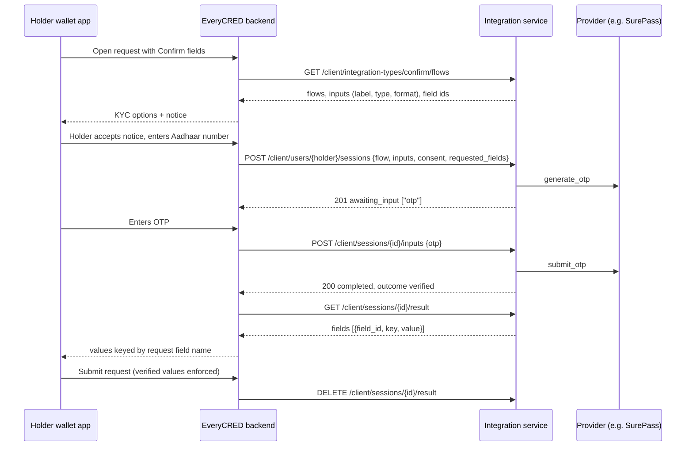
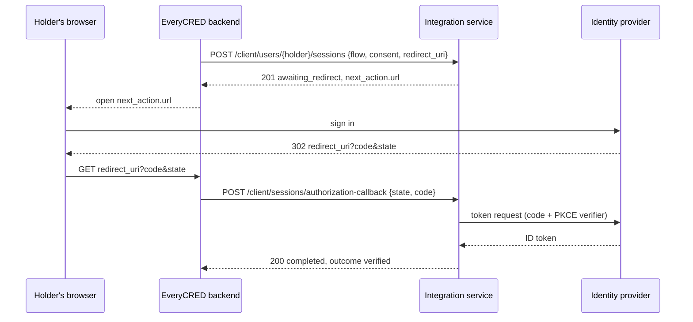

# Sessions (Confirm and Gather)

> Package: `app/features/sessions/` (worker in `app/worker.py`)
> Last updated: 2026-10-13

## Overview

A **session** runs one **flow** of an integration tool for one of a
client's users. It covers two integration types:

- **Confirm** (`purpose: verification`): is this person who they say
  they are? For example, an Aadhaar number followed by the OTP sent to
  the holder's phone, or a sign-in with the holder's Microsoft Entra ID
  account. The outcome is `verified` or `not_verified`.
- **Gather** (`purpose: gather`): fetch the holder's attributes from a
  system of record such as an HRMS or Entra ID, to put into a
  credential. The outcome is `gathered`.

Flows are part of the tool's `connector_config` (see
[connectors](../connectors.md#flows)), so adding a new verification
method is a matter of configuration, not code. There are two kinds:

| Kind | The holder... | Example |
|------|---------------|---------|
| `input` | types values the flow asks for | Aadhaar number, then OTP |
| `redirect` | signs in at the provider in a browser | Entra ID single sign-on |

Every session carries the holder's **consent record**, and the client
can limit what is kept, erase the result once used, and record a
withdrawal of consent. See [Privacy and the DPDP Act](#privacy-and-the-dpdp-act).

### How EveryCRED uses it

The holder never talks to this service; the EveryCRED backend relays
what the holder does in the wallet app.



For a `redirect` flow, the start call returns `awaiting_redirect` with
`next_action.url`. The holder signs in there; the provider redirects
their browser to the client's registered callback, and the client
relays `state` and `code` to `POST /client/sessions/authorization-callback`.



## Endpoints

All routes require `X-API-Key`. The client comes from the key, so a
client can only reach its own sessions (others return `404`).

| Method | Path | Summary |
|--------|------|---------|
| GET  | `/v1/client/integration-types/{type}/flows` | Describe the flows for a holder screen (`tool_code` to pick one of the type's tools) |
| POST | `/v1/client/users/{user_uuid}/sessions` | Start a session |
| GET  | `/v1/client/users/{user_uuid}/sessions` | List a user's sessions (`status`, `integration_type`, `limit`, `offset`) |
| GET  | `/v1/client/sessions/{id}` | Poll status |
| POST | `/v1/client/sessions/{id}/inputs` | Submit what the session is waiting for |
| POST | `/v1/client/sessions/authorization-callback` | Relay the provider's sign-in callback |
| GET  | `/v1/client/sessions/{id}/result` | Read the attributes and fields |
| DELETE | `/v1/client/sessions/{id}/result` | Erase the result once used |
| POST | `/v1/client/sessions/{id}/consent-withdrawal` | Record a withdrawal of consent |
| POST | `/v1/client/sessions/{id}/cancel` | Cancel and discard inputs |
| GET  | `/v1/client/kyc/verified-users` | Users whose KYC succeeded (`integration_type`, `flow`, `verified_after`, `user_uuid`, `limit`, `offset`) |

### Describe flows

`GET /v1/client/integration-types/confirm/flows` answers for the tool
chosen for `confirm` in the client's configuration:

```json
{
  "integration_type": "confirm",
  "tool_code": "surepass",
  "tool_name": "SurePass",
  "flows": [
    {
      "name": "aadhaar_otp",
      "purpose": "verification",
      "kind": "input",
      "description": "Aadhaar number, then the OTP sent to it",
      "inputs": [
        {"name": "id_number", "label": "Aadhaar number", "input_type": "number",
         "pattern": "[0-9]{12}", "min_length": null, "max_length": 12,
         "is_masked": true, "hint": null},
        {"name": "otp", "label": "OTP", "input_type": "otp",
         "pattern": "[0-9]{6}", "min_length": 6, "max_length": 6,
         "is_masked": false, "hint": null}
      ],
      "outputs": ["full_name", "date_of_birth"],
      "fields": [
        {"id": "00000000-0000-0000-0000-000000000001", "key": "full_name",
         "label": "Full name", "value_type": "string"}
      ]
    }
  ]
}
```

Render the form from `inputs`. Store a field's `id` against your own
field (EveryCRED keeps it in `field_mapping_reference_uuid`) and send it
in `requested_fields`; the result then names the value by that id.

### Start

```bash
curl -X POST \
  https://<host>/integration/v1/client/users/<holder uuid>/sessions \
  -H "X-API-Key: <client api key>" \
  -H "Content-Type: application/json" \
  -d '{
        "integration_type": "confirm",
        "flow": "aadhaar_otp",
        "reference": "<request id>",
        "inputs": {"id_number": "<aadhaar number>"},
        "consent": {
          "purpose": "Verify your identity to receive your credential",
          "notice_version": "2026-10-01",
          "language": "en",
          "consented_at": "2026-10-05T10:00:00Z",
          "reference": "<your consent record id>"
        },
        "requested_fields": ["00000000-0000-0000-0000-000000000001"]
      }'
```

| Field | Required | Notes |
|-------|----------|-------|
| `integration_type`, `flow` | yes | The flow of the chosen tool. |
| `tool_code` | no | One of the type's tools, when it has several (SurePass or Entra ID sign-in for Confirm, say). The type's default tool when omitted. A tool that does not serve the type gets `404 integration_tool_not_found`; a switched-off one `409`. |
| `consent` | yes | `consented_at` must be within the last 15 minutes (5 minutes of clock skew allowed). |
| `inputs` | no | Send what you have; a flow whose inputs are all present runs to the end in this call. Checked against the flow's input specs. |
| `redirect_uri` | `redirect` flows only | Must exactly match an entry in the client's `redirect_uris` setting for the tool (or the type). Rejected for other flows. |
| `requested_attributes` | no | Outputs to keep. |
| `requested_fields` | no | Tool field ids to read from the response. |
| `reference` | no | Your own reference, echoed back and in webhooks. |

Response (`201`):

```json
{
  "id": "0b8e...",
  "status": "awaiting_input",
  "awaiting_inputs": ["otp"],
  "next_action": null,
  "purpose": "verification",
  "outcome": null,
  "reference": "<request id>",
  "result_attributes": [],
  "result_fields": [],
  "consent": {"purpose": "...", "notice_version": "2026-10-01", "language": "en",
              "consented_at": "2026-10-05T10:00:00Z", "reference": "...",
              "withdrawn_at": null},
  "expires_at": "2026-10-05T10:30:00Z"
}
```

For a `redirect` flow the status is `awaiting_redirect` and
`next_action` is `{"type": "redirect", "url": "https://login..."}`. The
URL is returned only in this response; polling does not repeat it.

### Submit inputs

```bash
curl -X POST https://<host>/integration/v1/client/sessions/<id>/inputs \
  -H "X-API-Key: <client api key>" -H "Content-Type: application/json" \
  -d '{"inputs": {"otp": "123456"}}'
```

### Authorization callback

```bash
curl -X POST https://<host>/integration/v1/client/sessions/authorization-callback \
  -H "X-API-Key: <client api key>" -H "Content-Type: application/json" \
  -d '{"state": "<state from the redirect>", "code": "<code from the redirect>"}'
```

Send `error` instead of `code` when the provider returned one (the
holder cancelled, say); the session fails with
`authorization_declined`. `state` works once: it is cleared before the
code is exchanged, so a replay gets `404 authorization_not_found`.

### Result

```json
{
  "session_id": "0b8e...",
  "outcome": "verified",
  "attributes": {},
  "fields": [
    {"field_id": "00000000-0000-0000-0000-000000000001", "key": "full_name",
     "value": "..."}
  ],
  "data_expires_at": "2026-10-12T10:05:00Z"
}
```

`attributes` and `fields` are empty when `not_verified`. After the
result is deleted (retention ended, erased, or consent withdrawn) the
endpoint returns `410 result_expired`.

### Erase and withdraw

- `DELETE .../result` (`204`) deletes the result now. Call it once the
  values are saved where they belong. Repeating it is harmless; a
  session still running returns `409 result_not_ready`.
- `POST .../consent-withdrawal` cancels an unfinished session, deletes
  inputs and result, and records `consent.withdrawn_at`. Repeating it
  returns the same session unchanged.

If the secret store is unreachable during either call, the result's
`data_expires_at` is moved to now and the worker deletes it on its next
round; the call itself still succeeds.

## Users whose KYC succeeded

`GET /v1/client/kyc/verified-users` lists the client's users with at
least one session that completed with outcome `verified`, one item per
user, newest verification first. `total` counts users.

```json
{
  "items": [
    {
      "user_uuid": "387914dd-4a4e-4aad-8d18-2ce9b7d827ef",
      "verified_at": "2026-10-08T09:30:00Z",
      "session_id": "0b8e…",
      "integration_type": "confirm",
      "tool_code": "surepass",
      "flow": "aadhaar_otp"
    }
  ],
  "total": 1, "limit": 20, "offset": 0
}
```

- Each user appears once, with their most recent successful
  verification; read that session's `/result` for its attributes while
  they are kept.
- Filters (all optional, combinable): `integration_type`, `flow`,
  `verified_after` (ISO 8601; without a timezone it is read as UTC),
  and `user_uuid` to check one user. Without filters, every verified
  user is returned.
- `not_verified`, failed, expired, cancelled, unfinished, and gather
  sessions do not count.
- Ids only; no personal data.

## Lifecycle

| Status | Meaning |
|--------|---------|
| `awaiting_input` | Waiting for `awaiting_inputs`. |
| `awaiting_redirect` | Waiting for the holder to sign in at the provider. |
| `processing` | Calling the provider (brief). |
| `completed` | The provider answered; see `outcome`. |
| `failed` | No answer could be obtained; see `failure_code`. |
| `expired` | Not finished within `SESSION_TTL_MINUTES`. |
| `cancelled` | Cancelled by the client, or consent was withdrawn. |

| `failure_code` | Cause |
|----------------|-------|
| `provider_rejected` | Provider said no (with `not_verified`), or refused a gather request. |
| `provider_error` / `provider_timeout` | Provider unreachable, garbage response, too slow, or an ID token that failed validation. |
| `authorization_declined` | The provider returned an error to the redirect, or no code. |
| `unexpected_response` | A value the flow captures was missing from the response. |
| `missing_inputs` / `invalid_inputs` | An input could not be used. |
| `tool_credentials_missing` | The client has not stored the tool's credentials. |
| `flow_misconfigured`, `integration_tool_disabled`, ... | The setup changed while the session was open. A session always continues through the tool it started with, even if the type's default tool changes. |
| `session_expired` | Timed out. |

Problems found **before** a session is created are ordinary API errors
and create nothing:

| Status | `error.code` | Cause |
|--------|--------------|-------|
| `403` | `integration_not_enabled` | Type not enabled for the client. |
| `404` | `flow_not_found` | Unknown flow. |
| `422` | `unexpected_inputs` | Inputs the flow never uses. |
| `422` | `invalid_inputs` | An input breaks its spec (names only; values never echoed). |
| `422` | `consent_not_recent` | `consented_at` too old or in the future. |
| `422` | `invalid_redirect_uri` | Missing, unexpected, or not registered. |
| `422` | `unknown_attributes` / `unknown_fields` | Requested something the flow does not have. |

## Privacy and the DPDP Act

The client (EveryCRED, or the issuing organisation behind it) is the
data fiduciary; this service processes on its behalf. The session API
gives the client what it needs to meet the Digital Personal Data
Protection Act 2023:

| Obligation | How the session supports it |
|------------|-----------------------------|
| Notice and consent before processing (sections 5, 6) | `consent` is required on every new session. The client shows the notice; the service keeps purpose, notice version, language, time, and the client's reference with the session. |
| Purpose limitation and minimisation (sections 4, 6(1)) | `requested_attributes` and `requested_fields` keep only what the request needs. |
| Erasure once the purpose is served (section 8(7)) | `DELETE .../result`; results are also deleted after `SESSION_DATA_RETENTION_DAYS`. |
| Withdrawal of consent (section 6(4)-(6)) | `POST .../consent-withdrawal` stops processing and deletes the data. |
| Security safeguards (section 8(5)) | Inputs and results only in the secret store (KMS encrypted); the database and logs hold names and ids, never values. |

The service does not decide whether consent is valid in law; the
client must present a notice that meets section 5 and the DPDP Rules.

### Data handling

- Inputs (document numbers, OTPs), values captured between steps, and a
  pending sign-in's PKCE verifier and nonce are kept in the
  [secret store](../core/secret_store.md) under
  `clients/<client>/sessions/<id>/state` **only while the session is
  active**, and deleted when it finishes, fails, expires or is
  cancelled.
- A sign-in's `state` is stored only as a SHA-256 hash, and cleared on
  use. Access and refresh tokens from the provider are never stored.
- Result attributes and fields are stored in the secret store under
  `.../result` and deleted at `data_expires_at`
  (`SESSION_DATA_RETENTION_DAYS`, default 7), on erasure, or on
  withdrawal.
- The database row holds status, consent metadata, names of inputs and
  attributes, field ids, and references only. Status responses,
  webhooks and logs never contain values.
- Each provider call, and each sign-in code exchange
  (`authorization_code_exchange`), is recorded in
  `integration_operation_logs` (operation, success, status code,
  duration, request id) without inputs or results.

## Sign-in flows

A flow with an `authorization` block (see
[connectors](../connectors.md#sign-in-flows)) uses the OpenID Connect
authorization code flow with PKCE (S256), a random `state`, and a
`nonce`. On the callback the code is exchanged at the provider's token
endpoint with the client's secret, and the ID token is checked:
audience (`aud`, and `azp` when there are several audiences), issuer
(when configured), expiry, and nonce. Its signature is not checked
because it comes straight from the token endpoint over TLS, which
OpenID Connect Core section 3.1.3.7 allows.

The claims then act as the response data: `capture` copies values for
later steps, and a flow with no steps reads its `outputs` and
`verified_when` from them.

The access and refresh tokens are discarded, unless the flow sets
`steps_as_user`: then the access token authenticates the steps that run
right after sign-in (Graph `/me`, say), so they can only reach the
signed-in user's data. It is held in memory for that call only, never
stored in the session state, the result, or the logs.

Register the redirect URI in two places: in the provider's application
registration, and in the client's settings for the sign-in tool:

```bash
curl -X PUT https://<host>/integration/v1/client/integrations/entra-id-signin \
  -H "X-API-Key: <client api key>" -H "Content-Type: application/json" \
  -d '{"settings": {"environment": "prod",
                    "redirect_uris": ["https://api.example.com/v1/holder/kyc/callback"]}}'
```

## Output mapping

A flow's `outputs` map attribute names to dot paths in the final
step's data (`org.department`, `items.0.id`), or the ID token claims for
a sign-in-only flow, or to captured values (`session.request_ref`).
They are set in the tool's configuration by a super admin and apply to
every client. Attributes whose path is absent from the response are
left out.

## Field keys

The field keys a flow's provider response holds (`full_name`, `dob`,
`address.zip`...) are entered by a super admin in
`integration_tool_fields`, globally or for one client; see
[integration tools](integration_tools.md#field-keys). A client sends
their ids in `requested_fields`, and the result returns each value
read from that key with its `field_id`. Only keys are stored in the
database, never values.

## Webhooks and polling

When a session reaches `completed`, `failed` or `expired`, a
`session.completed`, `session.failed` or `session.expired` event is
queued for the client's [webhook](webhooks.md). The payload includes
`result_attributes` and `result_fields` (names and ids only). The
worker delivers it. Polling `GET /client/sessions/{id}` works without a
webhook.

## Worker

`python -m app.worker` (the `worker` compose service) runs every
`WORKER_INTERVAL_SECONDS`:

1. expires overdue sessions (polling also expires them on read),
2. delivers due webhook events with retries,
3. deletes results past retention, including those whose erasure was
   deferred because the secret store was unreachable.

Run exactly one worker per deployment. After each successful round it
touches a heartbeat file in `/tmp`; the compose health check
(`python -m app.worker --check`) marks the container unhealthy when no
round has succeeded for 2 minutes, e.g. while the database is down.

## Settings

| Variable | Default | Meaning |
|----------|---------|---------|
| `SESSION_TTL_MINUTES` | 30 | Time to finish a session, including a sign-in. |
| `SESSION_DATA_RETENTION_DAYS` | 7 | Longest a result is kept. |
| `WORKER_INTERVAL_SECONDS` | 5 | Worker round interval. |
| `CONNECTOR_TIMEOUT_SECONDS` | (existing) | Limit per provider call and per code exchange. |

Client settings for the type (`client_integration_configs.settings`):

| Key | Meaning |
|-----|---------|
| `environment` | Provider environment the tool defines. |
| `redirect_uris` | Exact redirect URIs allowed for sign-in flows. |

## Concurrency

Submitting inputs moves the session from `awaiting_input` to
`processing` with a conditional `UPDATE`, so if two submissions race,
one proceeds and the other gets `409 session_not_awaiting_input`. The
authorization callback claims the session from `awaiting_redirect` the
same way; the losing request gets `404 authorization_not_found`.

## Tests

- `tests/features/sessions/test_sessions.py`: lifecycle, webhooks,
  worker, privacy of stored values.
- `tests/features/sessions/test_consent_and_minimisation.py`: consent
  record and freshness, flow catalog, input specs, requested
  attributes and fields, erasure, withdrawal.
- `tests/features/sessions/test_sign_in_flows.py`: authorization URL,
  PKCE, code exchange, ID token checks, single-use state, redirect URI
  rules, unsafe configurations.
- `tests/features/sessions/test_multiple_tools.py`: several tools for
  one type, settings per tool, `tool_code` on sessions and flows, open
  sessions keeping their tool, the user listing.
