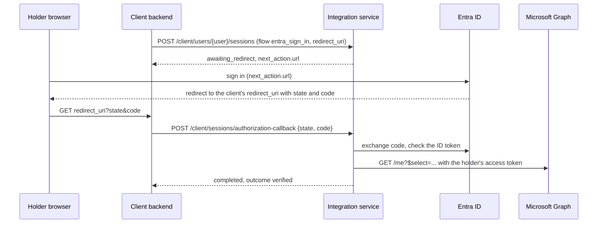

# Microsoft Entra ID Integration

> Last updated: 2026-10-13

Microsoft Entra ID is connected through the **configuration-driven HTTP
connector**: there is no Entra-specific code. The definition in
`docs/examples/microsoft-entra-id-tool.json` gives the tool one Confirm
flow, `entra_sign_in`:

1. The holder signs in with their work account (OpenID Connect,
   authorization code with PKCE). The holder types nothing.
2. The service calls Microsoft Graph `GET /me` with **the holder's own
   access token** (`steps_as_user`), so Microsoft returns that person's
   profile and nobody else's. The app has no permission to read other
   users.
3. The session is `verified` when Graph returns the profile.

The holder's access token is used for that one call, straight after
sign-in, and is never stored or logged. Only the fields the client
requests are kept, for the retention period.



## Before you start

You need an app registration in the organisation's Entra tenant:

- **Redirect URI** (platform *Web*): the client backend's callback,
  exactly as it is sent in `redirect_uri`. For EveryCRED this is
  `https://<backend host>/v1/holder/integration/callback`. The provider
  sends the holder's browser there, not to this service.
- **Client secret**: create one and note its expiry.
- **API permissions**: Microsoft Graph *delegated* permissions
  `openid`, `profile`, `email` and `User.Read` only. Do **not** add the
  application permission `User.Read.All`: it would let the app read
  every user in the tenant, which this flow never needs. If your tenant
  blocks user consent, an admin grants consent for these delegated
  permissions once.

With delegated `User.Read`, the token belongs to the holder who signed
in and Graph only serves that holder's own profile (`/me`). Neither the
client backend nor this service can ask for anyone else's data.

## 1. Define the tool

```bash
curl -X PUT https://<host>/integration/v1/integration-tools/microsoft-entra-id \
  -H "Authorization: Bearer <super admin token>" \
  -H "Content-Type: application/json" \
  --data @docs/examples/microsoft-entra-id-tool.json
```

This replaces the tool's whole definition and its global field list.
Fields that disappear (from an older flow, say) lose their ids, so
client fields mapped to them must be mapped again.

The definition:

- There is no tool-level `auth`: the app never gets a token of its own
  for Graph.
- `authorization` signs the holder in with the scope
  `openid profile email User.Read`, and `steps_as_user: true` sends the
  `get_me` step with the holder's access token. `issuer` is the
  tenant's v2.0 issuer, so ID tokens from another tenant are rejected.
  `"prompt": "login"` asks for a fresh sign-in every time; remove it to
  reuse an existing Microsoft session.
- `response` has no wrapper fields, because Graph returns the object
  itself.
- `fields` lists the Graph keys a client can request:
  `displayName`, `givenName`, `surname`, `mail`, `userPrincipalName`,
  `jobTitle`, `department`, `employeeId`, `mobilePhone`,
  `officeLocation`, `companyName` and `id`. To add one, add it to both
  `$select` in `get_me` and `fields`. A property the directory does not
  hold for the user is simply absent from the result.

## 2. Store each client's credentials

```bash
curl -X PUT https://<host>/integration/v1/clients/<client_id>/tools/microsoft-entra-id/credentials \
  -H "Authorization: Bearer <super admin token>" \
  -H "Content-Type: application/json" \
  -d '{"credentials": {"tenant_id": "<tenant id>", "client_id": "<application id>", "client_secret": "<client secret>"}}'
```

They go to the secret store and are never returned. Call the endpoint
again to rotate the secret before it expires.

## 3. Add the tool to the client's Confirm type

```bash
curl -X PUT https://<host>/integration/v1/clients/<client_id>/integrations/confirm \
  -H "Authorization: Bearer <super admin token>" \
  -H "Content-Type: application/json" \
  -d '{"is_enabled": true, "tool_code": "microsoft-entra-id", "is_default": false,
       "settings": {"environment": "production",
                    "redirect_uris": ["https://<backend host>/v1/holder/integration/callback"]}}'
```

`is_default: false` keeps the current default Confirm tool (SurePass,
say); callers name this tool with `tool_code`. `redirect_uris` belongs
to this tool and must contain the exact `redirect_uri` the backend
sends.

## 4. Use it from a client backend

Read the flow and its field ids:

```bash
curl "https://<host>/integration/v1/client/integration-types/confirm/flows?tool_code=microsoft-entra-id" \
  -H "X-API-Key: <client api key>"
```

Start a session with `tool_code`, `flow: "entra_sign_in"`, empty
`inputs`, the holder's consent, the `redirect_uri` and the
`requested_fields` ids; open `next_action.url` in the holder's browser;
relay the callback's `state` and `code` to
`POST /client/sessions/authorization-callback`; then read
`GET /client/sessions/{id}/result`. See
[sessions](../features/sessions.md).

In EveryCRED, map a subject's confirm fields to the `entra_sign_in`
field ids and give them the source system code `microsoft-entra-id`.
The backend then lists the tool as its own confirm step in the
request's metadata.

## Failure modes

| Symptom | Cause |
|---------|-------|
| `422 invalid_redirect_uri` on start | `redirect_uri` is not in the tool's `redirect_uris` setting |
| Microsoft shows `AADSTS50011` | The redirect URI is not registered on the app registration |
| Session `failed`, `authorization_declined` | The holder cancelled, or Microsoft returned an error |
| Session `failed`, `provider_error` | The code exchange or ID token checks failed (wrong tenant, client id or secret), Microsoft returned no access token, or Graph was unreachable |
| Session `completed`, `not_verified` | Graph refused the read (`provider_rejected`; usually `User.Read` was not consented) |
| Microsoft shows `AADSTS65001` | The holder or an admin has not consented to the delegated permissions |
| `409 tool_credentials_missing` | Step 2 was not done for this client |
