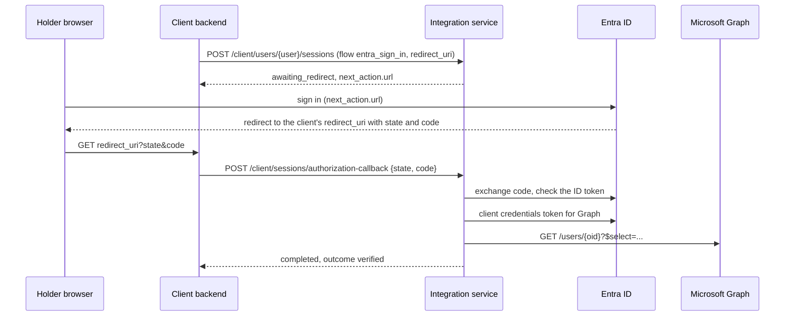

# Microsoft Entra ID Integration

> Last updated: 2026-10-13

Microsoft Entra ID is connected through the **configuration-driven HTTP
connector**: there is no Entra-specific code. The definition in
`docs/examples/microsoft-entra-id-tool.json` gives the tool one Confirm
flow, `entra_sign_in`:

1. The holder signs in with their work account (OpenID Connect,
   authorization code with PKCE). The holder types nothing.
2. The service takes the directory object id (`oid`) from the ID token
   and reads that user's profile from Microsoft Graph with the client's
   app-only token.
3. The session is `verified` when the account is enabled
   (`accountEnabled` is `true`), and `not_verified` otherwise.



## Before you start

You need an app registration in the organisation's Entra tenant:

- **Redirect URI** (platform *Web*): the client backend's callback,
  exactly as it is sent in `redirect_uri`. For EveryCRED this is
  `https://<backend host>/v1/holder/integration/callback`. The provider
  sends the holder's browser there, not to this service.
- **Client secret**: create one and note its expiry.
- **API permissions**: Microsoft Graph *application* permission
  `User.Read.All`, with admin consent. The sign-in itself needs only
  the delegated `openid`, `profile` and `email` scopes.

`User.Read.All` lets the app read any user in the tenant. The flow only
ever reads the user whose ID token it has just validated, because the
Graph path takes the id from that token, never from the caller.

## 1. Define the tool

```bash
curl -X PUT https://<host>/integration/v1/integration-tools/microsoft-entra-id \
  -H "Authorization: Bearer <super admin token>" \
  -H "Content-Type: application/json" \
  --data @docs/examples/microsoft-entra-id-tool.json
```

This replaces the tool's whole definition and its global field list.
Fields that disappear (from an older flow, say) lose their ids, so
client fields mapped to them must be mapped again.

The definition:

- `auth` gets an app-only Graph token (`https://graph.microsoft.com/.default`)
  for the `get_user` step.
- `authorization` signs the holder in. `issuer` is the tenant's v2.0
  issuer, so ID tokens from another tenant are rejected.
  `"prompt": "login"` asks for a fresh sign-in every time; remove it to
  reuse an existing Microsoft session.
- `response` has no wrapper fields, because Graph returns the object
  itself.
- `fields` lists the Graph keys a client can request:
  `displayName`, `givenName`, `surname`, `mail`, `userPrincipalName`,
  `jobTitle`, `department`, `employeeId`, `mobilePhone`,
  `officeLocation`, `companyName` and `id`. To add one, add it to both
  `$select` in `get_user` and `fields`.

## 2. Store each client's credentials

```bash
curl -X PUT https://<host>/integration/v1/clients/<client_id>/tools/microsoft-entra-id/credentials \
  -H "Authorization: Bearer <super admin token>" \
  -H "Content-Type: application/json" \
  -d '{"credentials": {"tenant_id": "<tenant id>", "client_id": "<application id>", "client_secret": "<client secret>"}}'
```

They go to the secret store and are never returned. Call the endpoint
again to rotate the secret before it expires.

## 3. Add the tool to the client's Confirm type

```bash
curl -X PUT https://<host>/integration/v1/clients/<client_id>/integrations/confirm \
  -H "Authorization: Bearer <super admin token>" \
  -H "Content-Type: application/json" \
  -d '{"is_enabled": true, "tool_code": "microsoft-entra-id", "is_default": false,
       "settings": {"environment": "production",
                    "redirect_uris": ["https://<backend host>/v1/holder/integration/callback"]}}'
```

`is_default: false` keeps the current default Confirm tool (SurePass,
say); callers name this tool with `tool_code`. `redirect_uris` belongs
to this tool and must contain the exact `redirect_uri` the backend
sends.

## 4. Use it from a client backend

Read the flow and its field ids:

```bash
curl "https://<host>/integration/v1/client/integration-types/confirm/flows?tool_code=microsoft-entra-id" \
  -H "X-API-Key: <client api key>"
```

Start a session with `tool_code`, `flow: "entra_sign_in"`, empty
`inputs`, the holder's consent, the `redirect_uri` and the
`requested_fields` ids; open `next_action.url` in the holder's browser;
relay the callback's `state` and `code` to
`POST /client/sessions/authorization-callback`; then read
`GET /client/sessions/{id}/result`. See
[sessions](../features/sessions.md).

In EveryCRED, map a subject's confirm fields to the `entra_sign_in`
field ids and give them the source system code `microsoft-entra-id`.
The backend then lists the tool as its own confirm step in the
request's metadata.

## Failure modes

| Symptom | Cause |
|---------|-------|
| `422 invalid_redirect_uri` on start | `redirect_uri` is not in the tool's `redirect_uris` setting |
| Microsoft shows `AADSTS50011` | The redirect URI is not registered on the app registration |
| Session `failed`, `authorization_declined` | The holder cancelled, or Microsoft returned an error |
| Session `failed`, `provider_error` | The code exchange or ID token checks failed (wrong tenant, client id or secret), or Graph was unreachable |
| Session `completed`, `not_verified` | The account is disabled, or Graph refused the read (`provider_rejected`; usually no admin consent for `User.Read.All`) |
| `409 tool_credentials_missing` | Step 2 was not done for this client |
